<div align="center">

# Daily Plan · 30-day Challenge
### برنامه روزانه · چالش ۳۰ روزه

A fillable 30-day planner: cover, calendar tracker and 30 daily pages.
English (LTR) and Farsi (RTL, Jalali calendar) · five colour themes · installable · works offline ·
optional end-to-end encrypted sync between your devices.

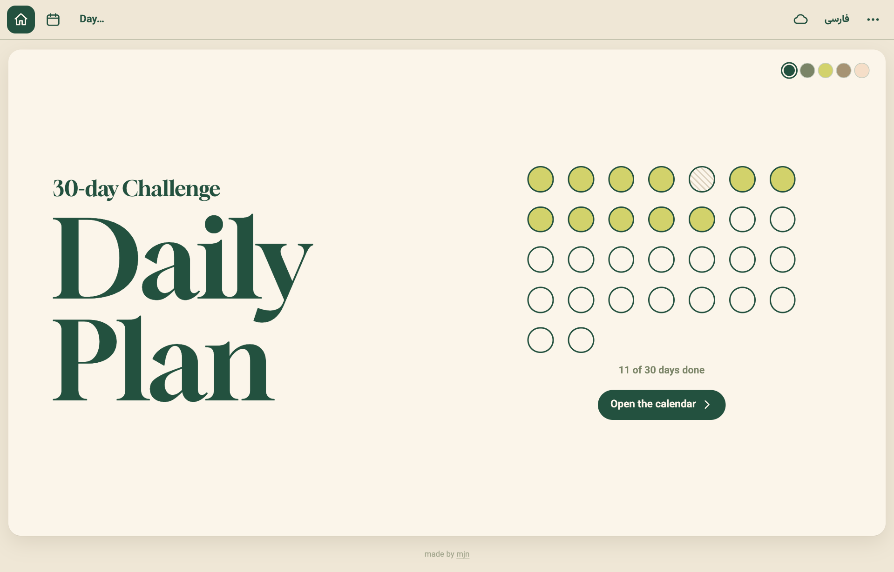

</div>

## Features

- **Cover** with a 30-dot progress tracker. The five swatches in the corner switch the theme.
- **Calendar** of all 30 days: bedtime, done/missed mark and mood per day, plus a challenge title and summary.
- **30 daily pages**: focus, study/work hours, wake/bed time (sleep is calculated), mood, 8-glass water tracker,
  workout, meals, an hour-by-hour schedule (05:00 → 01:00), four subject checklists and a daily summary.
- **English + فارسی** with full RTL layout, Persian digits and a **Jalali (Persian) or Gregorian** calendar.
- **Five themes** built from the cover palette: Forest, Sage, Lime, Tan, Peach.
- **No login.** Open it and write. Everything is saved on the device automatically.
- **Optional account sync** between phone and computer, end-to-end encrypted.
- **Offline & installable** (PWA), **print / save as PDF** (A4 landscape), JSON **export / import** backups.
- Phone friendly, with swipe left/right to change days.

## Screenshots

| Calendar | Day page |
|---|---|
| 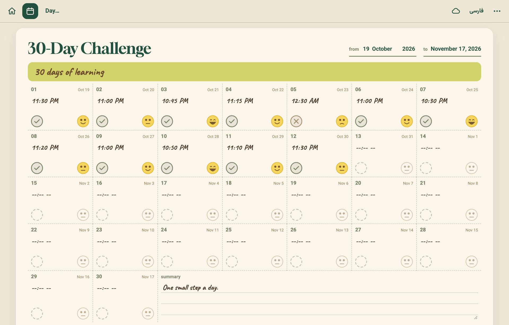 | 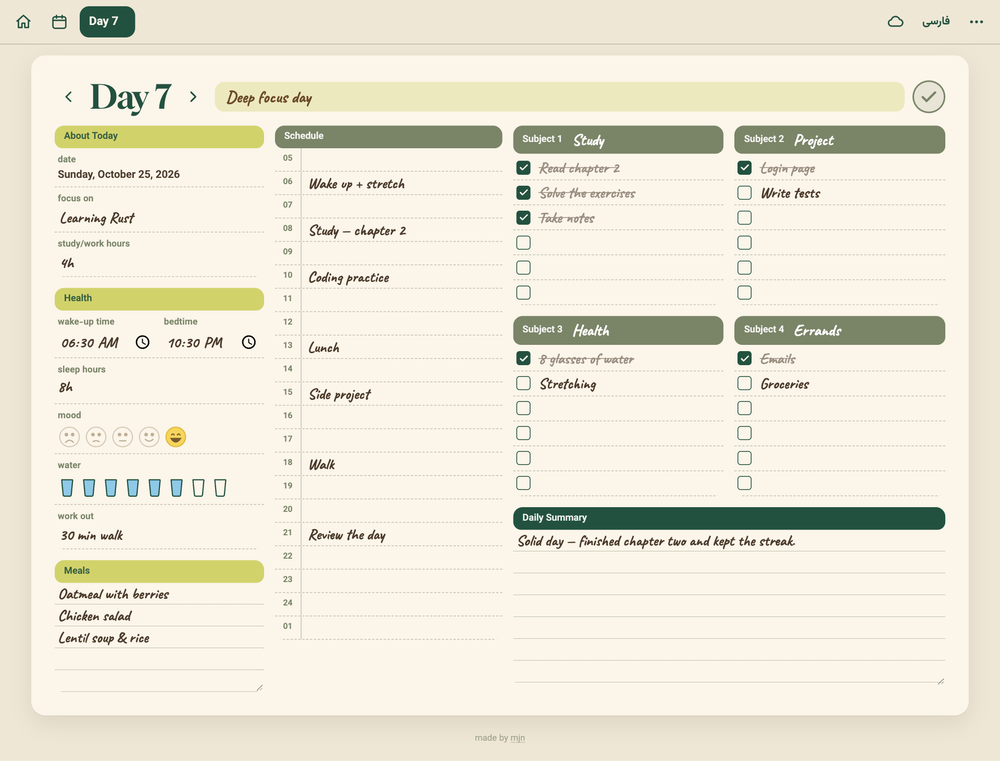 |

### Farsi / RTL (Jalali calendar)

| Calendar | Day page |
|---|---|
| 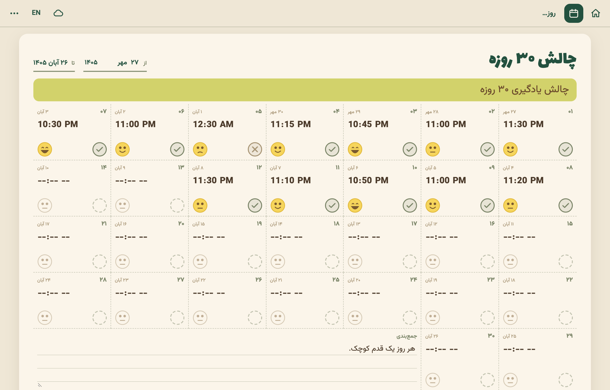 | 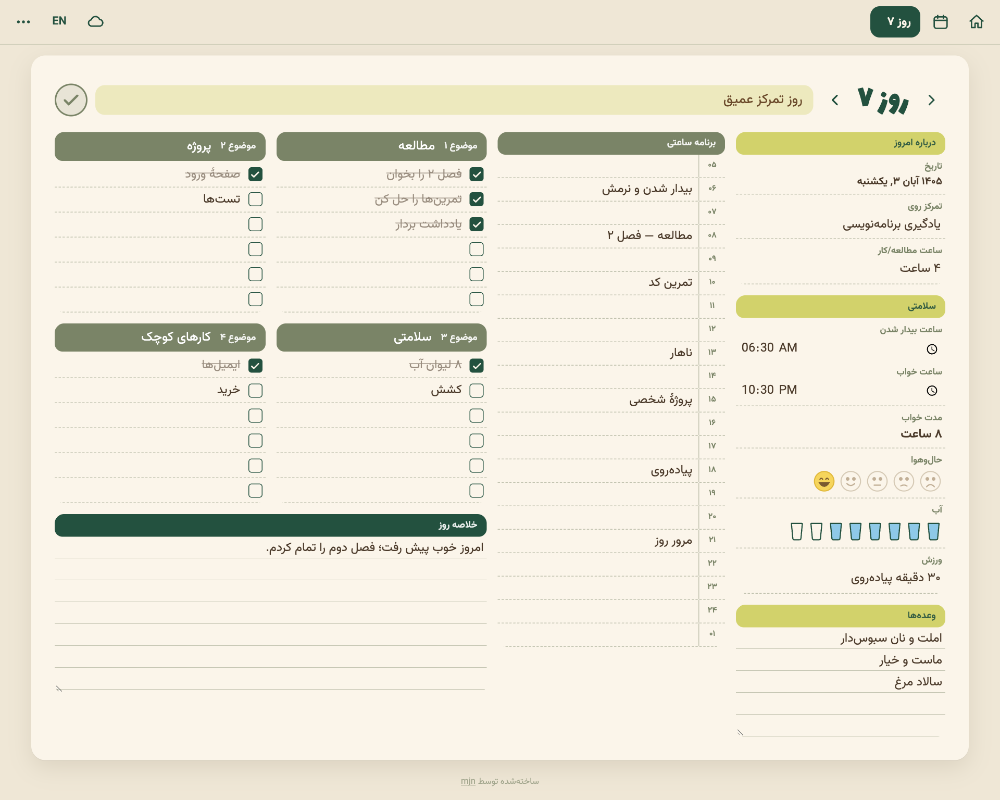 |

### Themes

Tap a swatch on the cover (or open ⋯ → Theme). The choice is remembered per device.

| Forest | Sage | Lime | Tan | Peach |
|---|---|---|---|---|
| 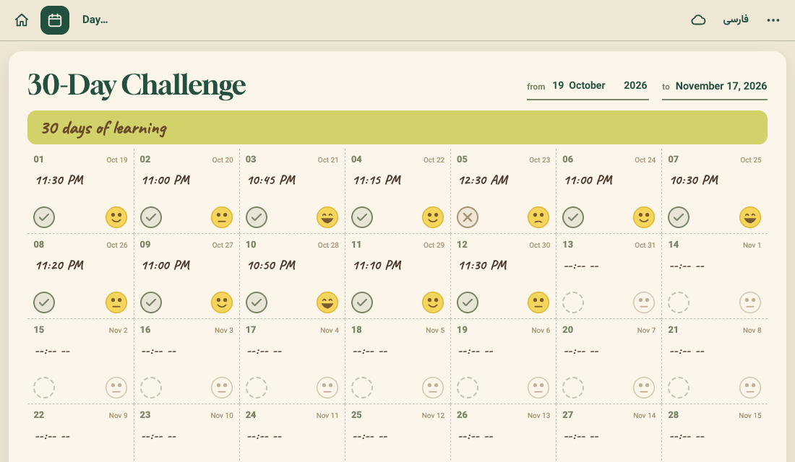 | 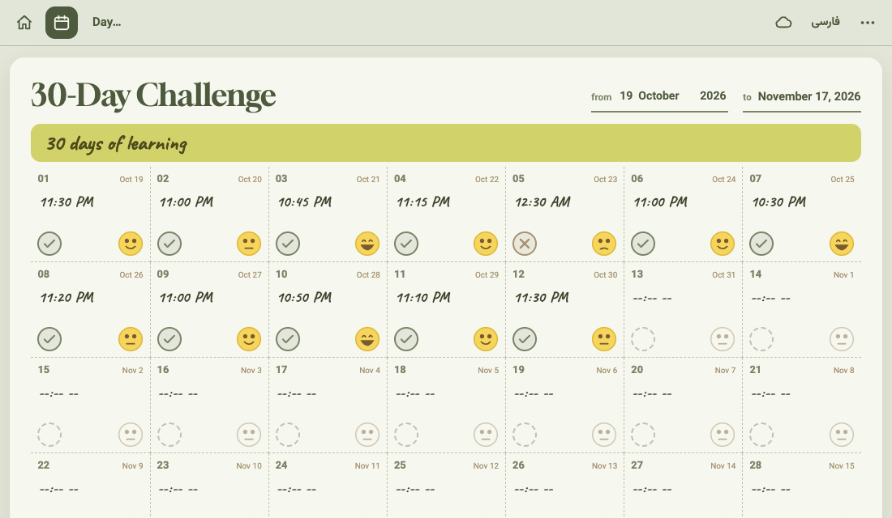 | 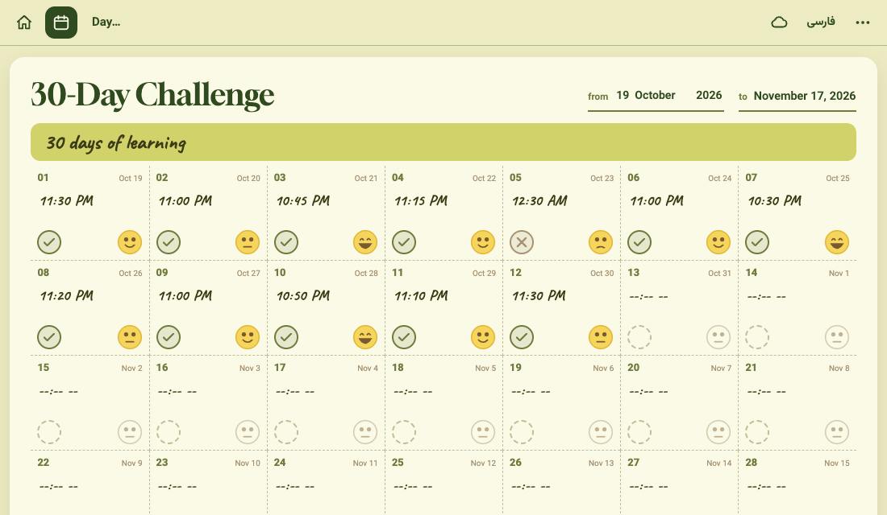 | 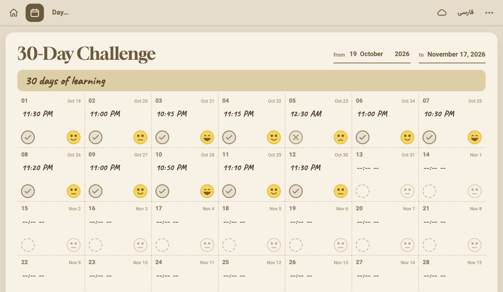 | 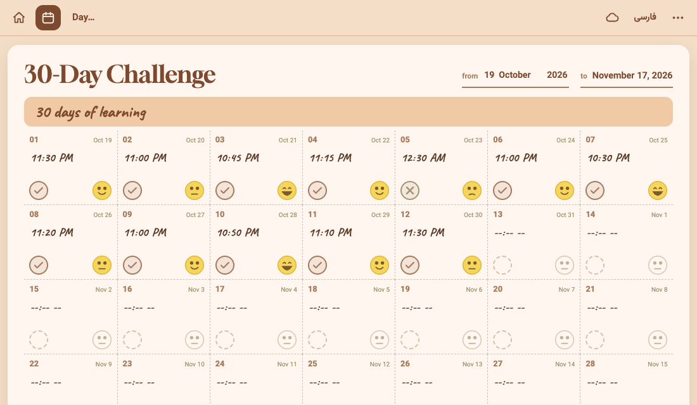 |

### On your phone

| Cover | Calendar | Day |
|---|---|---|
| 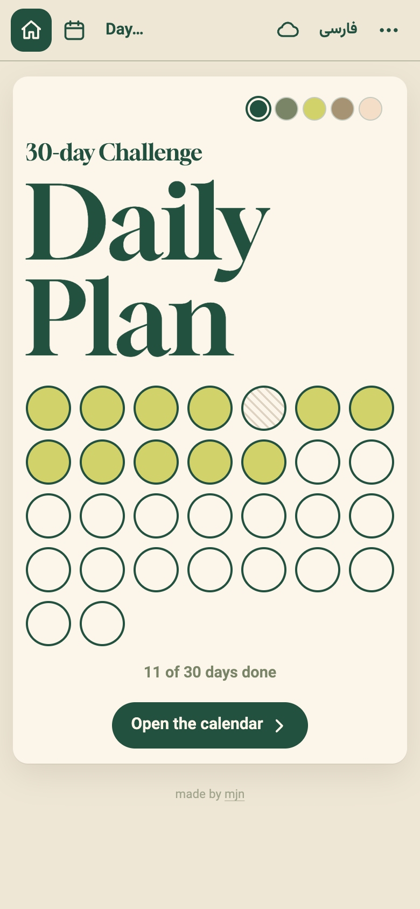 | 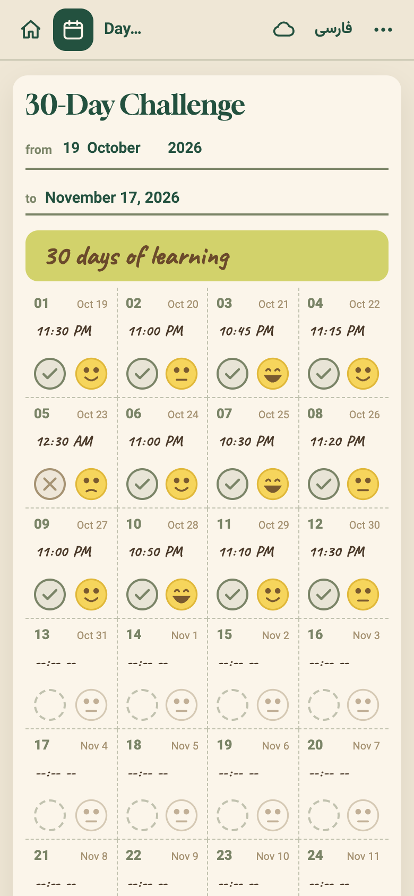 | 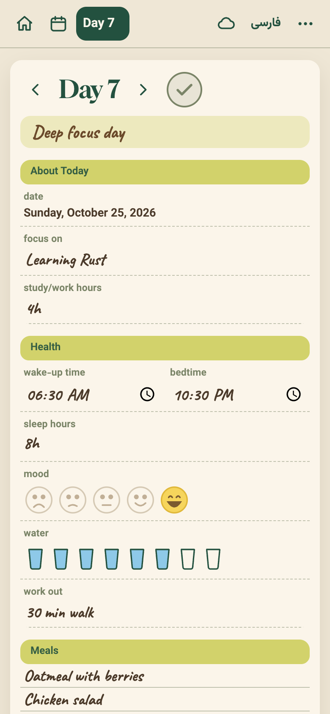 |

### Menu and sync

| ⋯ menu | Sync dialog |
|---|---|
| 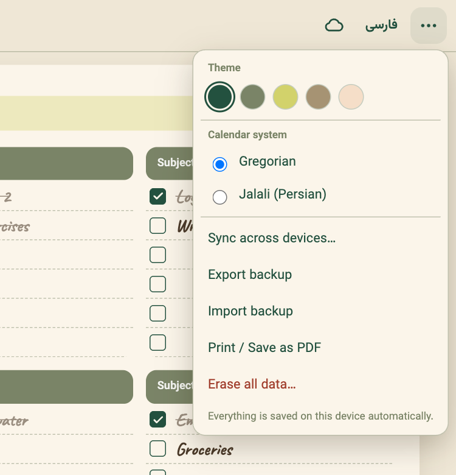 | 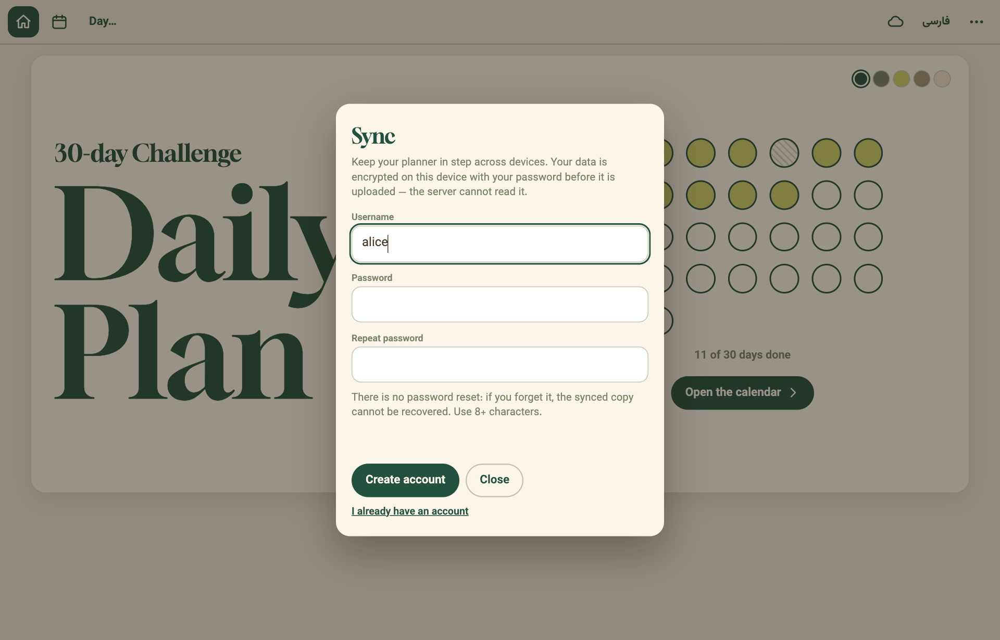 |

## Using it

- Everything saves on the device as you type. **⋯ → Export backup** downloads a JSON file;
  **Import backup** restores it (also a way to move data without an account).
- **Print / Save as PDF** is in the same menu.
- iPhone: Safari → Share → *Add to Home Screen*. Android / desktop Chrome: *Install app*.
- Language toggle (فارسی / EN) is in the top bar; calendar system (Jalali / Gregorian) is in ⋯.

## Sync between devices

Tap the cloud icon in the top bar → **Create account** (username + password), then **Sign in** with the same
details on your other devices. Changes sync automatically when you edit, when you return to the tab, and every
~45 seconds while it is open. Offline edits sync when you are back online.

**How it stays private.** Your password never leaves the device. From username + password the browser derives
(PBKDF2-SHA256, 600k iterations → HKDF) an account id, a login token and an AES-256-GCM key. The data is encrypted
on the device before upload, so the server only stores ciphertext.

**Merging.** Each day carries a timestamp and the newest edit wins per day (and per title/summary/start date),
so two devices can both be used without overwriting each other. *Erase all data* and *Import backup* replace the
cloud copy on every device. Language, calendar system and theme stay per device.

**Things to know**
- **There is no password reset.** Forget it and the cloud copy is unreadable. Keep an exported backup.
- Use a long, unique password: the encrypted data is only as strong as the password protecting it.
- Wrong-password attempts are rate-limited (10 per 15 minutes per account).
- ⋯ → Sync → **Delete cloud copy** removes your data from the server; your devices keep theirs.
- Clocks decide "newest", so keep your devices' date/time set automatically.

## Deploy on Vercel

You need the **whole folder**, not just `public/`. Without sync it is a plain static site and needs nothing else.

1. Push this folder to a GitHub repo and import it in Vercel (*Add New… → Project*). Framework Preset: **Other**.
2. *(Only for sync)* In the project: **Storage → Create → Upstash Redis** (Marketplace, free plan) → **Connect to Project**.
   Vercel adds `KV_REST_API_URL` and `KV_REST_API_TOKEN` automatically (`UPSTASH_REDIS_REST_URL` / `_TOKEN` also work, and any custom prefix such as `PLANNER_ACC_KV_REST_API_URL` is detected).
3. **Deploy** (redeploy once after connecting the database so the variables are picked up).

If Redis is not connected, the app still works fully; the sync dialog just says sync isn't set up.

Local preview of the app: `npx serve public`. To try sync locally: `vercel env pull && vercel dev`.

## When you edit files
Bump `VERSION` in `public/sw.js` so installed copies pick up the update.

## Structure
```
api/sync.js              encrypted account storage (Upstash Redis over REST, no dependencies)
vercel.json              output dir + headers
public/                  the app
  index.html
  assets/css/app.css     styles + the five themes (data-theme on <html>)
  assets/js/app.js       views, state, themes, sync UI
  assets/js/sync.js      key derivation, encryption, merge, API client
  assets/js/i18n.js      English / Farsi strings
  assets/js/dates.js     Gregorian + Jalali helpers
  sw.js, manifest        offline + install
docs/screenshots/        images used in this README
```

---

<div dir="rtl">

## راهنمای سریع (فارسی)

- برنامه بدون ورود و رمز باز می‌شود؛ هر چه بنویسی روی همان دستگاه ذخیره می‌شود.
- با پنج دایرهٔ رنگی روی جلد (یا منوی ⋯ ← پوسته) رنگ برنامه را عوض کن.
- **همگام‌سازی:** روی آیکون ابر بزن، یک نام کاربری و رمز بساز و در دستگاه دیگر با همان‌ها وارد شو. اطلاعات پیش از ارسال روی دستگاه رمزگذاری می‌شود و سرور نمی‌تواند آن را بخواند. **بازیابی رمز وجود ندارد**؛ از اطلاعات نسخهٔ پشتیبان بگیر.
- برای فعال‌شدن همگام‌سازی روی Vercel: Storage ← Upstash Redis ← Connect to Project و سپس یک بار Deploy.
- نسخهٔ پشتیبان و چاپ/PDF در منوی ⋯ است. آیفون: Safari ← Share ← Add to Home Screen.

</div>

---

<sub>Made by [mjn](https://github.com/mjn81)</sub>
